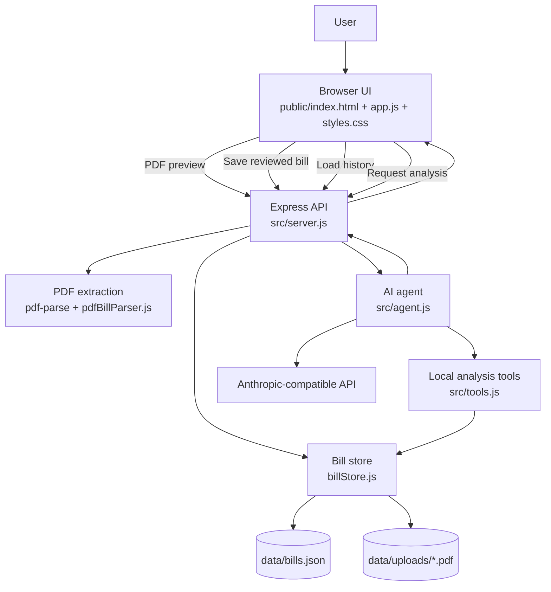
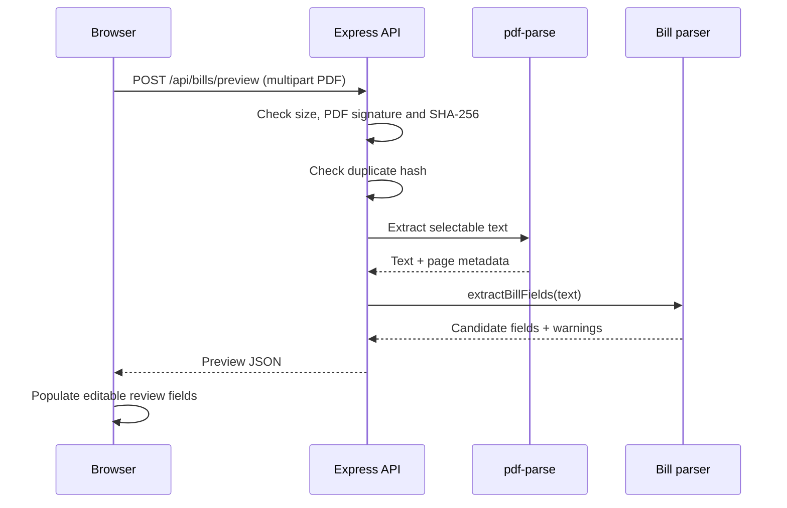
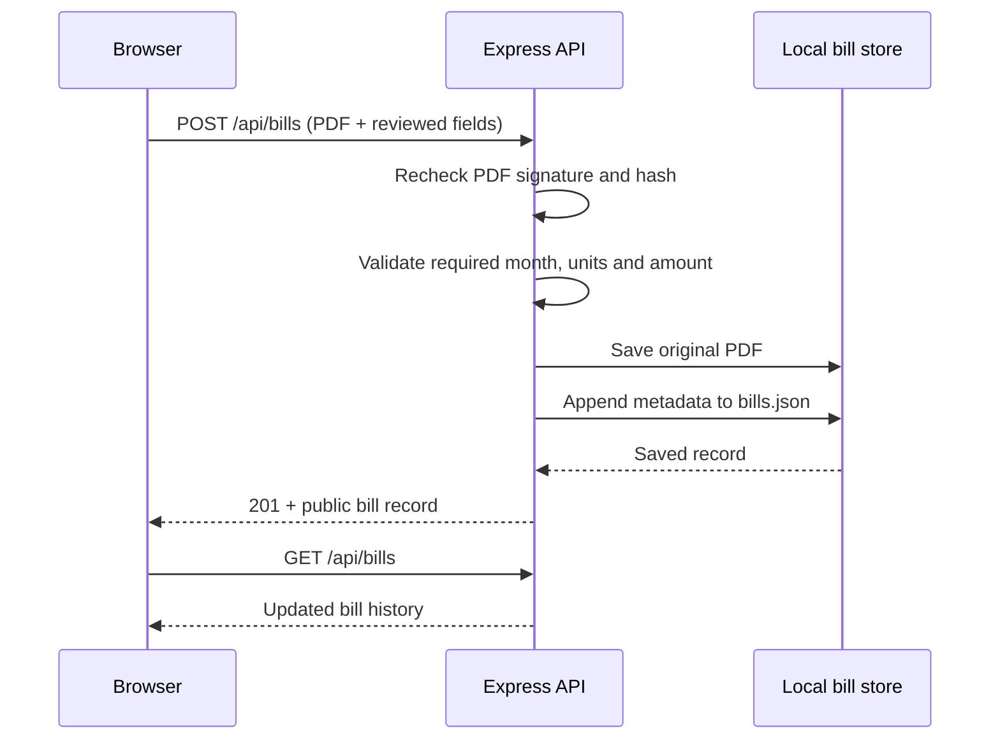
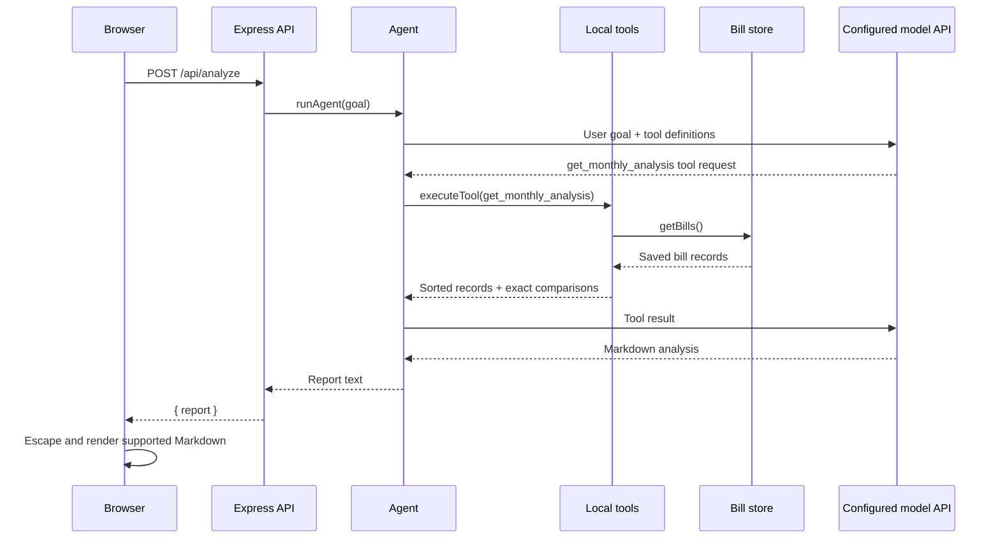

# Wattwise — Product, Architecture & UI Design System

> Living documentation for the current local-first Wattwise bill upload and analysis application. This document describes the implementation on `feature/pdf-bill-upload`; it is not a specification for features that have not yet been built.

## 1. Product overview

Wattwise helps a household or small energy user build a history of electricity bills and understand changes over time. The current application supports two bill categories:

- **Standard electricity bill** — consumption/imported units and bill amount.
- **Solar net-metered bill** — imported units, exported units, billed consumption, solar bank opening/closing balance, bill amount and net payable as separate values when those fields are present in the PDF.

The workflow is deliberately review-first: PDF extraction proposes values, the user checks and edits them, and only then are they saved to local history. The AI agent analyses saved records; it is not the source of truth for numeric calculations.

### Current capabilities

- Responsive browser UI for PDF upload and bill review.
- PDF file-size limit of 10 MB, PDF signature check, and SHA-256 duplicate detection.
- Text-based PDF extraction using `pdf-parse`.
- Separate parsing paths/fields for standard and KSEB-style solar net-metered bills.
- User correction of extracted fields before saving.
- Local persistence of PDF files and bill metadata.
- Monthly overview with bill count, total imported energy and total bill amount.
- Dedicated Solar analytics page for net-metered records, including monthly import/export bars, recorded bank-balance trend and a detailed solar bill table.
- AI tool-calling analysis over saved bill records.
- Deterministic month-on-month arithmetic before the AI writes its narrative.
- Markdown report rendering into styled headings, comparison tables, lists and paragraphs.

### Explicit limitations

- OCR for scanned/image-only PDFs is not implemented. Such bills need manual entry in the review form.
- The parser currently contains KSEB-oriented patterns; other utility formats may need additional parser rules and test fixtures.
- There is no user authentication, multi-user tenancy, cloud sync, or hosted production storage in this local application.
- Solar bill analytics visualise only values explicitly recorded in the bills. Actual solar generation and total household consumption are not calculated unless the source records provide those measurements.
- The local JSON store is suitable for a single-user prototype, not concurrent multi-user production workloads.

## 2. Main user journey

1. Choose or drop a PDF into the upload area.
2. The browser posts the file to `POST /api/bills/preview`.
3. The server checks the file type/signature and duplicate hash, extracts PDF text and parses candidate bill fields.
4. The review form displays the detected bill type and editable values.
5. The user verifies the values against the original PDF and submits the form.
6. The server validates required values, stores the original PDF and appends metadata to the local bill history.
7. The monthly overview reloads from `GET /api/bills`.
8. The user requests analysis. The agent calls local tools, receives sorted saved records and deterministic comparisons, and returns a Markdown report.
9. The browser safely escapes report text and renders supported Markdown structures as styled UI elements.

## 3. Architecture

### 3.1 High-level component view



### 3.2 Runtime responsibilities

| Component | Responsibility |
|---|---|
| `public/index.html` | Main dashboard structure, upload form, review form, bill history table and analysis container.
| `public/solar.html` | Dedicated solar analytics page with energy charts, bank-balance trend and solar bill history. |
| `public/app.js` | Main dashboard upload interactions, API calls, form population, bill history rendering and Markdown report rendering.
| `public/solar.js` | Loads saved bills and renders the dedicated solar analytics page. |
| `public/styles.css` | Layout, responsive behaviour, visual tokens, form styles and report presentation. |
| `src/server.js` | Express app, static assets, upload middleware, REST endpoints, validation and error responses. |
| `src/services/pdfBillParser.js` | Extracts structured values from the text returned by the PDF parser. |
| `src/services/billStore.js` | Reads/writes bill metadata and manages local storage directories. |
| `src/tools.js` | Exposes bill retrieval, deterministic monthly analysis and pairwise comparison tools. |
| `src/agent.js` | Calls the configured Anthropic-compatible model and executes requested local tools. |
| `src/index.js` | Optional CLI entry point for the agent. |

### 3.3 Request and data flow

#### Preview a bill



#### Save a reviewed bill



#### Analyse saved bills



### 3.4 API surface

| Method | Endpoint | Purpose |
|---|---|---|
| GET | `/api/bills` | Return saved bill metadata for history. |
| POST | `/api/bills/preview` | Parse an uploaded PDF and return suggested fields without saving. |
| POST | `/api/bills` | Save the PDF and user-reviewed bill fields. |
| POST | `/api/analyze` | Run the agent against saved bills and return a Markdown report. |

### 3.5 Persistence model

Current storage is file-system based:

```text
data/
├── bills.json       # Bill metadata records
└── uploads/
    └── <uuid>.pdf   # Original uploaded PDFs
```

A bill record currently includes:

| Field | Meaning |
|---|---|
| `id` | Generated record identifier. |
| `billType` | `standard` or `net-metered`. |
| `month`, `billDate` | Billing period label and bill date. |
| `units`, `importedUnits` | Imported/consumption units in kWh. |
| `exportedUnits` | Exported solar energy in kWh, when available. |
| `billedConsumption` | Utility billed-consumption figure, when available. |
| `bankOpening`, `bankClosing` | Solar bank balances, when available. |
| `amount` | Bill amount before/at the bill total line. |
| `netPayable` | Net payable after adjustments, when available. |
| `consumerNumber` | Optional consumer identifier. |
| `originalName`, `storedFile` | Original filename and local stored filename. |
| `sha256` | Content hash used for duplicate detection. |
| `uploadedAt` | Upload timestamp. |

The API omits the internal hash and stored-file path from ordinary history responses. The consumer number is currently included in the saved record and preview/review UI; treat the local data directory as sensitive.

### 3.6 Analysis calculation rules

The `get_monthly_analysis` tool sorts records by the billing month and computes adjacent-month comparisons. For a current value (C) and previous value (P):

```text
Difference = C - P
Percentage change = ((C - P) / P) * 100
```

Percent change is unavailable when the previous value is zero or either value is missing. Missing values must not be silently converted to zero.

The analysis distinguishes:
- **Imported units** from **billed consumption**.
- **Exported units** from imported energy.
- **Bill amount** from **net payable**.
- **Recorded facts** from observations and unverified explanations.

The agent should not claim that one metric caused another to change. A short run of monthly bills is not enough to establish seasonality or solar-generation efficiency.

## 4. UI design system

The current visual direction is calm, nature-inspired and utility-focused: warm off-white surfaces, muted green typography, soft sage panels and a bright lime accent for primary actions.

### 4.1 Typography

The stylesheet imports two Google Fonts:

| Font | Role | Usage |
|---|---|---|
| **Manrope** | Display and heading family | Brand wordmark, hero heading, section headings, metric values and report headings. |
| **DM Sans** | Interface and body family | Body copy, labels, buttons, tables, form inputs, helper text and report paragraphs. |

Recommended hierarchy as implemented:

| Element | Family | Approx. size / weight |
|---|---|---|
| Hero heading | Manrope | `clamp(36px, 6vw, 60px)`, 800 |
| Section heading | Manrope | 21px, 700 |
| Metric value | Manrope | 23px, 700 |
| Report title | Manrope | 26px, 700 |
| Report section heading | Manrope | 20px, 700 |
| Body copy | DM Sans | 13–14px, 400 |
| Table body | DM Sans | 12px, 400 |
| Labels / eyebrow | DM Sans | 10–11px, 600–700 |
| Helper / status text | DM Sans | 11–12px, 400 |

The hero uses tight letter spacing; body copy uses generous line-height for readability.

### 4.2 Color palette

The values below are taken from the current `public/styles.css` declarations. Some colors are applied directly rather than through CSS custom properties.

| Token name | Hex | Usage |
|---|---|---|
| Canvas / page background | `#f4f7f3` | Main application background. |
| Primary text | `#1c2923` | Main text and brand. |
| Heading / deep green | `#1e3027` | Analysis report headings. |
| Dark panel | `#24352c` | AI insights call-to-action panel. |
| Body muted | `#69776e` | Intro and supporting copy. |
| Muted green | `#6b826e` | Eyebrow labels. |
| Sage panel | `#e9efe6` | Metric cards and quiet controls. |
| Pale green surface | `#f9fbf8` | Upload dropzone. |
| Lime accent | `#d7f36b` | Primary buttons and brand mark. |
| Lime pale | `#e5f1cf` | Observation number markers. |
| Green accent | `#73914b` | Hero accent and active dropzone. |
| Border | `#e2e9e1` | Panels and report containers. |
| Input border | `#dce5dc` | Form controls. |
| Table header | `#f1f6ec` | Report table header background. |
| Warning tag surface | `#f4f1df` | Bill-type / verification pill. |
| Error | `#b43f36` | Upload and API error messages. |
| Success | `#4e7c43` | Successful upload status. |

**Color usage guidance**

- Use lime for the primary action, not for large blocks of body text.
- Use deep green for high-emphasis headings and dark CTA surfaces.
- Use sage/off-white for secondary surfaces and cards.
- Keep body text muted but sufficiently dark for comfortable reading.
- Reserve red for errors and amber/sand tones for verification states.

### 4.3 Layout, spacing and shape

| Pattern | Current treatment |
|---|---|
| Main content width | `max-width: 1060px`, centered. |
| Desktop page padding | 28px. |
| Mobile page padding | 18px. |
| Main panel radius | 18px. |
| Inputs / buttons radius | 9–10px. |
| Metric card radius | 14px. |
| Panel padding | 28px desktop, 19px mobile. |
| Form grid | Two columns; collapses to one column below 650px. |
| Metric summary | Three columns; collapses to one column below 650px. |
| Table | Horizontally scrollable on narrow screens. |
| Shadows | Soft, low-opacity green/neutral shadows. |

### 4.4 Components

#### Brand and navigation
- Compact wordmark with a rounded lime square containing “W”.
- Thin bottom border separates the top bar from the page.
- Small status indicator uses a green dot and muted text.

#### Upload dropzone
- Dashed sage border, pale surface and centered upload icon.
- Supports file picker and drag/drop.
- Hover/drag state changes the border and background to the green accent palette.
- File size and PDF expectation are stated near the section heading.

#### Review form
- Clear step label and bill-type pill.
- Two-column layout with labels above inputs.
- Full-width consumer-number field.
- Extractor notes and warnings are visually separate from editable values.
- User review is required before the save action.

#### Monthly overview
- Three soft-sage metric cards for uploaded bills, total imported energy and total bill amount.
- History is presented in a bordered white table panel.
- Bill type, import/export values, bill amount/net payable and upload date remain separate columns.

#### AI analysis panel
- Deep green CTA surface with a lime-toned eyebrow.
- Contrasting quiet button invites the user to run analysis.
- A dedicated report surface appears below after analysis begins.

#### Analysis report
- Markdown headings become a clear title/section hierarchy.
- Markdown tables become bordered, horizontally scrollable data tables.
- Ordered/unordered lists become separate soft-sage insight cards.
- Paragraphs use muted text and generous line-height.
- A loading indicator is shown while the report is being prepared.
- The browser escapes report text before applying supported formatting.

### 4.5 Responsive behaviour

The current breakpoint is 650px. The main navigation links the bill dashboard and dedicated solar analytics page.
- Page gutters and panel padding reduce.
- Hero typography scales down.
- Form and metric grids collapse to one column.
- The AI CTA stacks vertically.
- Report tables preserve their columns and scroll horizontally instead of squeezing numeric content.

### 4.6 Accessibility and content rules

- Use semantic headings in document order.
- Keep visible labels associated with form controls.
- Status messages use live regions where provided.
- Do not communicate success/error by color alone; retain text labels.
- Preserve keyboard access to file input, buttons and form controls.
- Keep table headers meaningful and avoid hiding important values on mobile.
- Format numeric values consistently and include units/currency in labels.
- Distinguish bill amount from net payable everywhere.
- Mark missing values as unavailable; do not display missing values as zero.

## 5. Development and configuration

### Environment variables

| Variable | Purpose |
|---|---|
| `ANTHROPIC_AUTH_TOKEN` | API key/token used by the configured model endpoint. |
| `ANTHROPIC_BASE_URL` | Optional API base URL; defaults to Anthropic's API. |
| `ANTHROPIC_MODEL` | Model identifier required for analysis. |
| `PORT` | Optional web server port; defaults to `3000`. |

The upload and local-history features do not require AI credentials. AI analysis does.

### Commands

```bash
npm install
npm start       # Web app at http://localhost:3000
npm run agent   # CLI agent
npm test        # Node test runner for service test files
```

## 6. Security, privacy and operational notes

- Uploaded PDFs may contain personal and account information. Keep `data/` out of version control and restrict filesystem access.
- The current app is a local development application. Do not expose it to the public internet without authentication, authorization, HTTPS, CSRF protections, rate limiting and a production upload/storage policy.
- Validate file size, PDF signature and content hash on the server; never rely only on the browser's `accept` attribute or MIME type.
- Avoid logging PDF text, consumer identifiers or full bill records.
- Store API credentials in local environment configuration and never commit `.env`.
- Keep a backup of `data/bills.json` and `data/uploads/` if bill history matters.
- The current JSON file store does not provide database transactions or safe concurrent multi-process writes. Move to a transactional database before multi-user deployment.

## 7. Recommended next design/architecture increments

These are recommendations, not current capabilities:

1. Add chart components for imported/exported energy, bill amount and solar bank balance.
2. Add parser fixtures and regression tests for each supported utility/bill layout.
3. Add OCR as an optional fallback for scanned PDFs.
4. Move local JSON persistence to SQLite for a stronger single-user local experience, or PostgreSQL for multi-user hosting.
5. Add authentication, user-scoped bill ownership and tenant isolation before cloud deployment.
6. Add report export (PDF/CSV) and a report summary with clearly labelled facts, observations and hypotheses.
7. Centralize the CSS colors, typography, spacing and radius values into CSS custom properties to make future theming easier.
